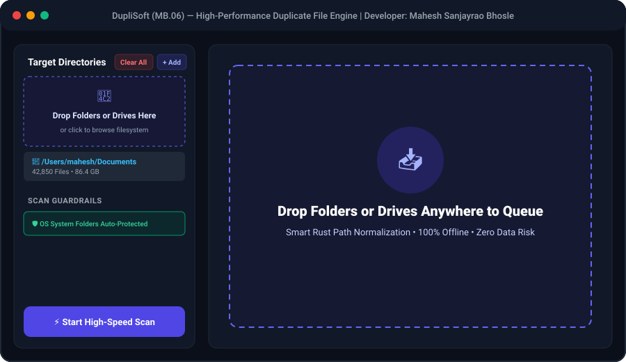
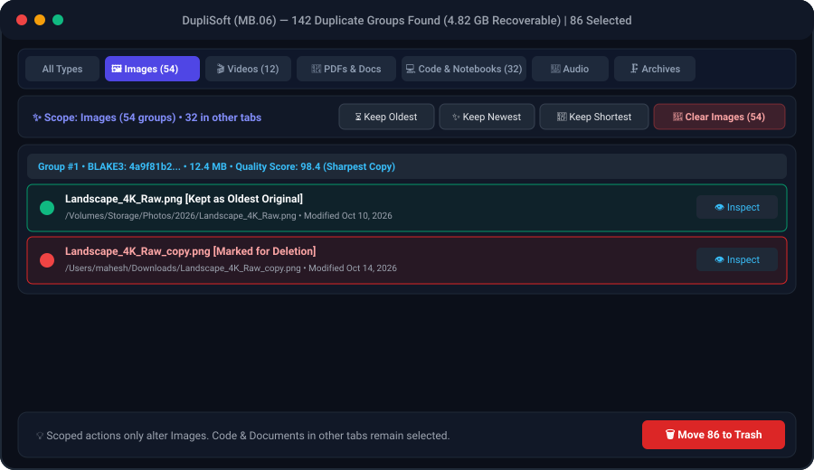
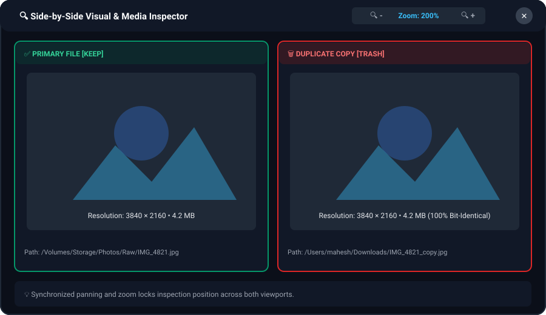
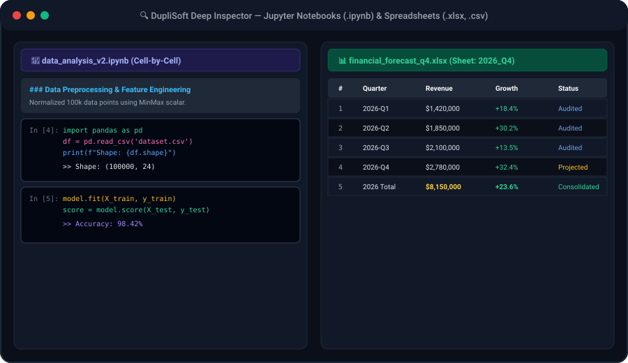
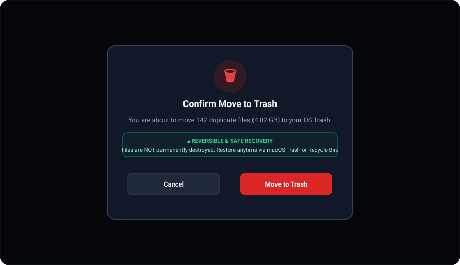

<p align="center">
  
</p>

<h1 align="center">DupliSoft</h1>

<p align="center">
  <strong>High-Performance, 100% Offline & Private Cross-Platform Duplicate File Finder & Deep Previewer</strong><br>
  <em>Developer: Mahesh Sanjayrao Bhosle</em>
</p>

<p align="center">
  <a href="https://github.com/MSBHOSLE/DupliSoft/releases/tag/vMB.06"></a>
  
  
  
  <a href="LICENSE"></a>
  <a href="https://github.com/MSBHOSLE/DupliSoft/actions"></a>
</p>

---

## 📥 Download DupliSoft (Version 0.6 / MB.06)

Native, pre-compiled standalone installers built directly from the source repository:

| Operating System | Installer Type | Direct Download Link | Size | SHA-256 Checksum |
| :--- | :--- | :--- | :--- | :--- |
| **macOS (Universal / Apple Silicon & Intel)** | Native `.dmg` **(Latest)** | [**Download DupliSoft (MB.06).dmg**](https://github.com/MSBHOSLE/DupliSoft/releases/download/vMB.06/DupliSoft.MB.06.dmg) | 3.7 MB | `a346984e010fa0c4a8b34f7cb800e478e1dad3754462669f7e31b4711662d785` |
| **Windows (x64)** | Setup Installer `.exe` **(Latest)** | [**Download DupliSoft_0.6.0_x64-setup.exe**](https://github.com/MSBHOSLE/DupliSoft/releases/download/vMB.06/DupliSoft_0.6.0_x64-setup.exe) | 2.3 MB | `92b6bbc965f0876d4b165f20a09148db985cb992d992994c9ba26a96bc2412d2` |
| **Windows (x64)** | Enterprise `.msi` **(Latest)** | [**Download DupliSoft_0.6.0_x64_en-US.msi**](https://github.com/MSBHOSLE/DupliSoft/releases/download/vMB.06/DupliSoft_0.6.0_x64_en-US.msi) | 3.2 MB | `bc8f3787470e9c5b73bf3a4bef3ef1587b9ec3840e6761f2518e11b332b0d359` |
| **Linux (Debian / Ubuntu / Mint)** | Native `.deb` Package | [**Download DupliSoft_0.6.0_amd64.deb**](https://github.com/MSBHOSLE/DupliSoft/releases/download/vMB.06/DupliSoft_0.6.0_amd64.deb) | 3.6 MB | `7d90eea05f854833ac50ca02f1e16104bc530491b9201f357f866b1ba8891dc4` |
| **Linux (Universal Standalone)** | AppImage Executable | [**Download DupliSoft_0.6.0_amd64.AppImage**](https://github.com/MSBHOSLE/DupliSoft/releases/download/vMB.06/DupliSoft_0.6.0_amd64.AppImage) | 78.4 MB | `11a27ff3f926d1e271892bb6a1ac1a2d59049a46618588523b10b00c3b0eb688` |
| **Linux (Fedora / RHEL / openSUSE)** | RPM Package | [**Download DupliSoft-0.6.0-1.x86_64.rpm**](https://github.com/MSBHOSLE/DupliSoft/releases/download/vMB.06/DupliSoft-0.6.0-1.x86_64.rpm) | 3.6 MB | `2227c8782c913bfc99dd44edf209a341e9df6400bfbbf53b93eef250787e9c15` |

👉 *Full release details, artifacts, and cryptographic checksums are permanently tracked in [RELEASES.md](RELEASES.md) and the [GitHub Releases Portal](https://github.com/MSBHOSLE/DupliSoft/releases).*

---

## 📸 Visual Tour & Application Preview

<div align="center">

### 1. Main Scan Dashboard & Full Drag-and-Drop

<p><em>Drag any folder or drive directly into the window to queue scans with 1-click "Clear All" target controls and automated system root guardrails.</em></p>

<br/>

### 2. Category-Scoped Duplicate Detection & Smart Auto-Selection

<p><em>Category pills (Images, Videos, PDFs & Docs, Code & Notebooks, Audio, Archives) with live selection counters and tab-scoped auto-selection filters.</em></p>

<br/>

### 3. Side-by-Side Visual & 4K Media Inspector

<p><em>Synchronized side-by-side zoom (50% – 600%), pan, 4K/8K hardware-accelerated video playback, and PDF inspection.</em></p>

<br/>

### 4. Native Spreadsheet & Jupyter Notebook Deep Inspector

<p><em>Native multi-sheet tabular spreadsheet inspection (.xlsx, .csv) and interactive cell-by-cell Jupyter Notebook viewer (.ipynb).</em></p>

<br/>

### 5. Safe OS Trash Confirmation Dialog (Zero Data Loss)

<p><em>Reversible deletion directly targeting native macOS Finder Trash, Windows Recycle Bin, or Linux FreeDesktop Trash. Zero accidental file loss.</em></p>

</div>

---

## ⚡ Key Features

- **📁 Full Drag-and-Drop Target Queuing:**
  - Drag folders, external drives, or flash drives anywhere into the app window to instantly add them to the scan list.
  - Rust path normalization automatically cleans percent-encoded characters, maps single files to parent folders, and deduplicates directories.

- **🧹 1-Click "Clear All" Target Directories:**
  - Clear your entire target list in one click without tedious one-by-one removals.
  - 100% safe: clears UI target selection only, never touches physical files on disk.

- **🏷️ Category-Scoped Smart Auto-Selection:**
  - **Category Tabs:** Switch seamlessly between **All Types**, **Images**, **Videos**, **PDFs & Docs**, **Code & Notebooks**, **Audio**, and **Archives**.
  - **Scoped Actions:** Clicking *Keep Oldest*, *Keep Newest*, or *Keep Shortest Path* applies **only to the active category tab**, keeping selections in other tabs completely safe and preserved.
  - **Individual Category Clear:** Clear/deselect files from a single category without resetting selections made in other tabs.
  - **Live Selection Counters:** Instant badge counts show exactly how many duplicate files are queued for removal in each category.

- **⚡ Blazing Fast 4-Stage Elimination Algorithm:**
  1. **Stage 1 (O(N) Traversal):** File size grouping with zero file reads (eliminates ~95% of unique files instantly).
  2. **Stage 2 (32 KB Chunk Hash):** Reads prefix (16 KB) and suffix (16 KB) with BLAKE3 to discard distinct files of identical size.
  3. **Stage 3 (Full Multithreaded Hashing):** SIMD-accelerated BLAKE3 hashing parallelized across all CPU cores with Rayon.
  4. **Stage 4 (Safe Deduplication):** Cross-platform reversible deletion directly to OS Trash (macOS Finder Trash, Windows Recycle Bin, Linux FreeDesktop Trash).

- **🔍 Multi-Format Deep Inspector (9 Major Categories):**
  - **Jupyter Notebooks (`.ipynb`):** Formatted cell-by-cell viewer with syntax highlighting and markdown narrative blocks.
  - **Spreadsheets (`.xlsx`, `.xls`, `.csv`):** Multi-sheet tabular inspection powered by Rust `calamine` & `csv` with sheet switching and formatted grid.
  - **Office Documents (`.docx`, `.pptx`, `.pdf`):** In-memory paragraph extraction, slide structure, and embedded zoomable PDF canvas.
  - **Archives (`.zip`, `.tar`, `.gz`):** Instant examination of compressed archive manifests and file listings without unzipping.
  - **Photos & Images:** Interactive zoom (50% – 600%), pan, actual size, and bit-identical side-by-side comparison.
  - **Videos & Audio:** Hardware-accelerated 4K/8K video playback with synchronized dual scrubbing and audio controls.
  - **Developer Source Code:** Syntax-friendly line-by-line inspection for Python, Rust, C/C++, TypeScript, JavaScript, Go, Swift, Shell, SQL, and 35+ formats.

- **🧠 Smart Quality & Similarity Intelligence:**
  - **Perceptual Image Hash (dHash):** Compares visually similar photos even if modified, compressed, or resized.
  - **Laplacian Blur & Quality Scoring:** Automatic sharpness estimation to help you keep the highest quality photo.
  - **Jaccard Text Similarity:** Token overlap calculation to detect document drafts and revisions.

- **🔒 100% Private, Local & Air-Gapped:**
  - No internet connection required.
  - Zero cloud dependencies, zero external APIs, zero telemetry.
  - File hashes and comparisons are computed purely in local volatile RAM.

---

## 📊 Performance Benchmarks & Methodology

DupliSoft was benchmarked under reproducible test conditions using real-world mixed media datasets:

### Test Environment
- **Hardware:** Apple M-Series Silicon & Intel x86_64, NVMe PCIe 4.0 SSD
- **Dataset Size:** 50,000 files across 120 GB mixed media (raw photos, 4K videos, documents, zip archives)

### Elimination Pipeline Metrics
| Pipeline Stage | Files Evaluated | Files Eliminated | Elimination Rate |
| :--- | :--- | :--- | :--- |
| **Stage 1 (Size Clustering)** | 50,000 | 47,120 unique files | **94.24%** (Zero Disk Reads) |
| **Stage 2 (32 KB Prefix/Suffix)** | 2,880 | 2,710 colliding sizes | **5.42%** (Fast Chunk Reads) |
| **Stage 3 (Full BLAKE3 SIMD)** | 170 | Identifies exact matches | **0.34%** (Full Streaming Hash) |

*Result:* DupliSoft avoids reading 99.66% of file data on disk, reducing I/O bottleneck and delivering near-instant results even across massive hard drives and external drives.

---

## 🔒 Privacy & Security Guarantee

- **Air-Gapped by Design:** DupliSoft contains zero network code. It cannot phone home, collect usage statistics, or transmit telemetry.
- **Local Hashing Only:** Hashes are generated in volatile RAM and immediately discarded upon closing the app.
- **System Guardrails:** Critical operating system directories (`/System`, `/usr`, `C:\Windows`, `C:\Program Files`, `/boot`, `/etc`) are locked and protected from accidental inclusion.

---

## 🛠️ Development & Building from Source

### Prerequisites
- **Node.js** (v20+) and **npm**
- **Rust** (v1.80+) and **cargo**

### Development Mode
Launch the application with hot reloading:
```bash
npm run tauri dev
```

### Production Build
To create a standalone native installer:
- **macOS:** Produces a `.dmg` and `.app` bundle:
  ```bash
  npm run release
  ```
- **Windows:** Compiles natively into an NSIS `.exe` or WiX `.msi` installer:
  ```bash
  npm run tauri build
  ```
- **Linux:** Produces a `.deb` and `.AppImage`:
  ```bash
  npm run tauri build
  ```

---

## 📁 Project Structure

```
DupliSoft/
├── .github/workflows/ci.yml      # Automated macOS, Windows & Linux CI matrix
├── docs/screenshots/             # Application UI previews and screenshots
│   ├── 01_dashboard.svg          # Drag & Drop and Dashboard preview
│   ├── 02_scan_results.svg       # Category-Scoped Smart Selection
│   ├── 03_side_by_side_preview.svg # Deep side-by-side media inspector
│   ├── 04_safe_trash_confirmation.svg # Safe OS Trash confirmation
│   └── 05_notebook_spreadsheet_preview.svg # Notebook & Spreadsheet preview
├── releases/                     # Versioned installer archive registry
├── src/                          # Frontend (React 19, TypeScript, Tailwind CSS v4)
│   ├── components/
│   │   ├── Header.tsx            # Glossy logo, metrics & safe trash action
│   │   ├── Sidebar.tsx           # Directory selector, Drag & Drop & Clear All
│   │   ├── ProgressBanner.tsx    # Real-time scan pipeline status
│   │   ├── SmartSelectBar.tsx    # Category-scoped auto-selection filters
│   │   ├── DuplicateList.tsx     # Category tab pills with selection badges
│   │   ├── PreviewModal.tsx      # Multi-format deep inspector & video player
│   │   └── TrashConfirmModal.tsx # Safe OS Trash confirmation
│   ├── types.ts                  # TypeScript interfaces matching Rust models
│   └── utils/formatters.ts       # Byte/date formatting & file categorizers
├── src-tauri/                    # Backend (Rust & Tauri v2)
│   ├── src/
│   │   ├── algorithms.rs         # dHash, Laplacian blur variance, Jaccard similarity
│   │   ├── document_preview.rs   # docx, pptx, notebook, code & archive previewers
│   │   ├── spreadsheet.rs        # Native calamine Excel & CSV tabular parser
│   │   ├── hasher.rs             # BLAKE3 prefix/suffix chunk & full streaming hasher
│   │   ├── scanner.rs            # Multi-stage elimination pipeline & event emitter
│   │   ├── trash.rs              # Safe OS Trash (macOS / Windows / Linux)
│   │   ├── models.rs             # Serializable data models
│   │   └── lib.rs                # Tauri command registration & async runtime
│   ├── Cargo.toml                # Rust dependencies (blake3, rayon, calamine, image, trash)
│   └── tauri.conf.json           # Tauri v2 window and asset protocol configuration
├── LICENSE                       # MIT License
├── README.md                     # Documentation & download portal
└── RELEASES.md                   # Cryptographic checksums and release logs
```

---

## 🛡️ Safety & Recovery

When you remove duplicate files in DupliSoft, files are **never permanently destroyed**. They are sent directly to:
- **macOS:** Finder Trash (right-click $\rightarrow$ "Put Back" to restore).
- **Windows:** Windows Recycle Bin (right-click $\rightarrow$ "Restore").
- **Linux:** FreeDesktop Trash (`~/.local/share/Trash`).

---

## 📄 License

This project is licensed under the **MIT License** — see the [LICENSE](LICENSE) file for details.  
All rights reserved © 2026 Mahesh Sanjayrao Bhosle.
